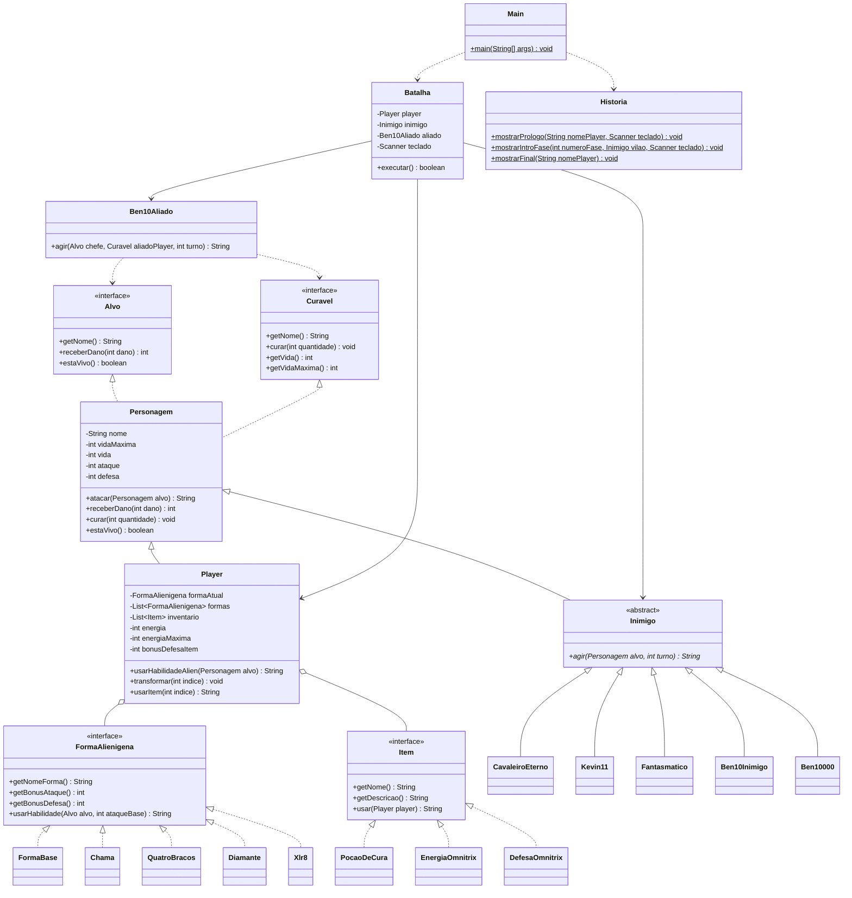
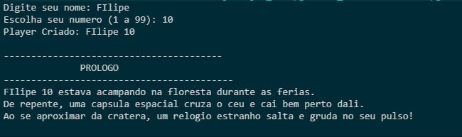
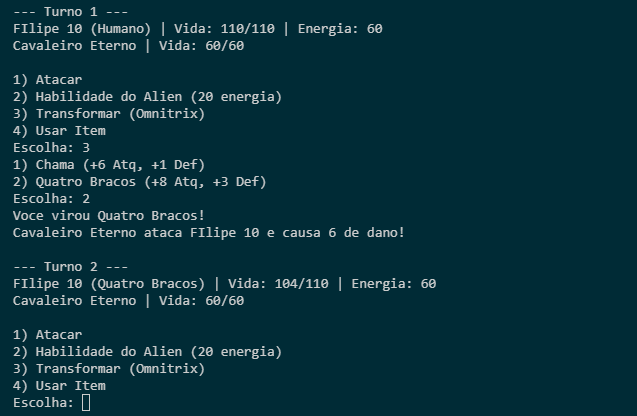
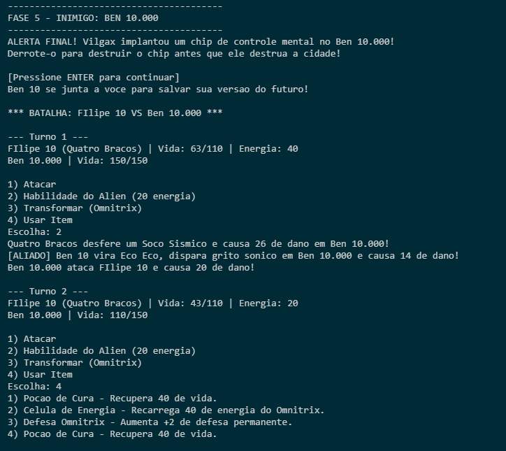

# RPG Ben 10

Jogo de RPG de turno em Java feito no console para a disciplina de Paradigmas de Programação, aplicando Programação Orientada a Objetos e os princípios SOLID.

## Como funciona o jogo

No começo você digita seu nome e escolhe um número (exemplo: Joao 11). Depois do prólogo, onde o personagem encontra o Omnitrix, o jogo passa por 5 fases:

1. Fase 1: Cavaleiro Eterno (libera o alien Diamante e dá o item Defesa Omnitrix)
2. Fase 2: Kevin 11 (libera o alien XLR8 e dá uma Poção de Cura)
3. Fase 3: Fantasmático (dá o item Energia Omnitrix)
4. Fase 4: Ben 10 (dá uma Poção de Cura e uma Energia Omnitrix)
5. Fase 5: Ben 10.000, que está controlado por um chip de Vilgax. Nessa batalha final o Ben 10 entra como aliado para atacar o chefe e curar sua vida.

Em cada turno da luta você pode escolher:
- Atacar: golpe normal somando o bônus do alien atual.
- Habilidade do Alien: ataque especial da forma atual (gasta 20 de energia).
- Transformar: troca o alien no Omnitrix (Humano, Chama, Quatro Braços, Diamante ou XLR8).
- Usar Item: usa Poção de Cura, Energia Omnitrix ou Defesa Omnitrix da mochila.

## Como compilar e executar

Precisa ter o Java JDK 17 ou superior instalado. Abra o terminal na pasta raiz do projeto e rode:

```bash
mkdir out
javac -encoding UTF-8 -d out src/rpg/*.java
java -cp out rpg.Main
```

## Diagrama de Classes



## Onde o SOLID foi usado

- S (Responsabilidade Única): cada classe cuida de uma parte do jogo. A Historia só mostra os textos, a Batalha controla os turnos, Player e Inimigo cuidam dos seus atributos e ataques, e cada item aplica só o seu efeito.
- O (Aberto/Fechado): dá para adicionar novos inimigos (herdando de Inimigo), novos aliens (implementando FormaAlienigena) ou novos itens (implementando Item) sem precisar mexer na classe Batalha.
- L (Substituição de Liskov): todos os vilões (CavaleiroEterno, Kevin11, Fantasmatico, Ben10Inimigo e Ben10000) funcionam no lugar da classe Inimigo no array de fases do Main e nas batalhas. O mesmo vale para os aliens e itens nas listas do Player.
- I (Segregação de Interfaces): em vez de uma interface grande, foram criadas interfaces menores e separadas: Alvo (só para receber dano), Curavel (só para curar vida), FormaAlienigena e Item.
- D (Inversão de Dependência): o Ben10Aliado e os aliens dependem das interfaces Alvo e Curavel em vez de depender direto de Player ou Ben10000. O Player também usa listas das interfaces FormaAlienigena e Item.

## Prints do jogo





